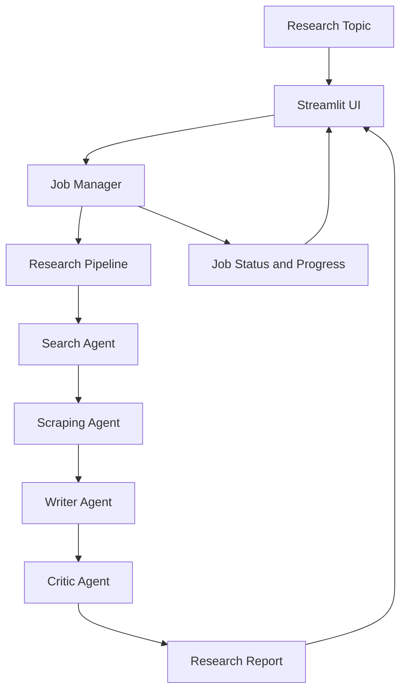
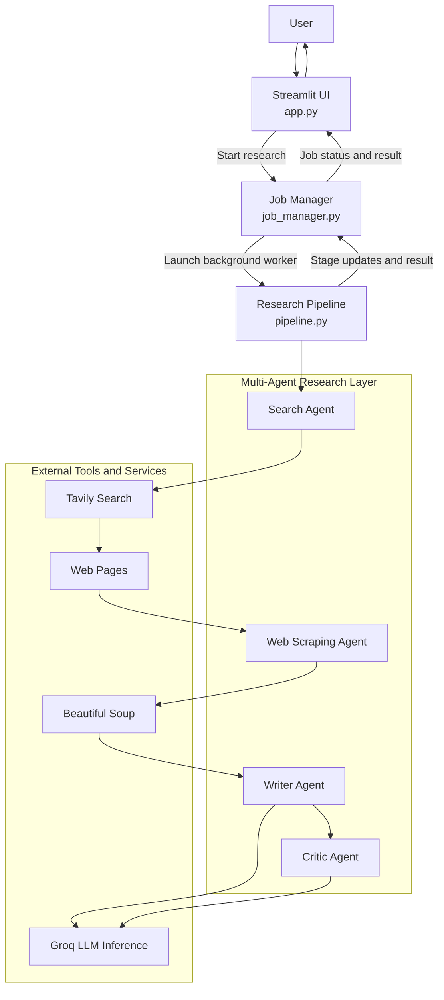

# ORBIT — Multi-Agent AI Research Assistant

**Research smarter. Let specialized AI agents do the work.**

ORBIT is a Streamlit-based AI research application that transforms a research topic into a structured report through a multi-agent workflow.

Rather than relying on a single AI model for the entire task, ORBIT coordinates specialized agents for web search, content extraction, report writing, and critique. It also includes a background job manager to track long-running research tasks and their execution stages.

## Features

- **Multi-agent research:** Separate search, scraping, writing, and critique responsibilities.
- **Web search:** Retrieve relevant information using Tavily.
- **Web scraping:** Extract readable page content using Beautiful Soup.
- **AI report generation:** Synthesize gathered information into a structured research report.
- **AI critique:** Review generated research through a dedicated critique stage.
- **Background execution:** Run research tasks in separate threads to keep the application responsive.
- **Job tracking:** Track job IDs, execution status, progress stages, and results.
- **Cooperative cancellation:** Allow running tasks to respond to cancellation requests.
- **Modular architecture:** Separate agents, tools, pipeline orchestration, and job management.

## How ORBIT Works



## Architecture Overview

ORBIT follows a modular, multi-agent architecture in which the Streamlit interface, background job manager, research pipeline, and specialized AI agents have distinct responsibilities.

The architecture separates **job execution and lifecycle management** from **research processing**, making the workflow easier to maintain and extend.

### System Architecture



### Component Responsibilities

| Component | Responsibility |
|---|---|
| `app.py` | Accepts research topics and presents job progress and results through Streamlit. |
| `job_manager.py` | Creates research jobs, assigns unique IDs, launches background threads, tracks status, and handles cancellation requests. |
| `pipeline.py` | Coordinates the research stages and passes information between agents. |
| Search Agent | Finds relevant web sources using Tavily. |
| Web Scraping Agent | Extracts readable content from selected web pages. |
| Writer Agent | Synthesizes the gathered research into a structured report. |
| Critic Agent | Reviews the generated report and provides feedback. |
| External services | Supply web search, page content, and language-model inference capabilities. |

### Research Execution Flow

1. The user submits a research topic through the Streamlit interface.
2. The job manager creates a job record and starts a background worker.
3. The worker invokes the research pipeline.
4. The pipeline coordinates search, scraping, writing, and critique.
5. Progress callbacks communicate the current stage to the job manager.
6. The completed report or an error is recorded in the job state.
7. The Streamlit interface retrieves the job status and displays the result.

### Background Processing and Cancellation

The job manager and research pipeline work together to support asynchronous execution.

- **Job manager:** Controls the job lifecycle, status updates, and cancellation events.
- **Research pipeline:** Performs the actual research and checks for cancellation when appropriate.
- **Streamlit interface:** Retrieves job information so users can monitor the task.

Cancellation is cooperative rather than an immediate forced termination. The running pipeline must check its cancellation event and stop its work when cancellation is requested.

### Design Principle

ORBIT separates the concerns of **orchestration, research execution, and user interaction**.

This modular structure makes it possible to modify individual agents, adjust the research workflow, or improve job management without redesigning the entire application.

## Technology Stack

| Technology | Purpose |
|---|---|
| Python | Core application logic |
| Streamlit | Interactive user interface |
| LangChain | AI agent and language-model orchestration |
| Groq | Language-model inference |
| Tavily | Web search |
| Beautiful Soup | HTML parsing and content extraction |
| Python threading | Background research execution |

## Getting Started

### 1. Clone the repository

```bash
git clone https://github.com/shubhamsharmaer/ORBIT.git
cd ORBIT
```

Adjust the repository name in the clone URL if your GitHub repository uses a different name.

### 2. Create a virtual environment

```bash
python -m venv .venv
```

Activate it:

**Windows**

```bash
.venv\\Scripts\\activate
```

**Linux / macOS**

```bash
source .venv/bin/activate
```

### 3. Install dependencies

```bash
pip install -r requirements.txt
```

### 4. Configure API credentials

Create a `.env` file in the project root:

```env
GROQ_API_KEY=your_groq_api_key
TAVILY_API=your_tavily_api_key
```

- `GROQ_API_KEY` — Used for Groq model access.
- `TAVILY_API` — Used for web search.

Configure any additional provider credentials required by your selected agents.

**Security:** Keep your `.env` file private. Never commit API keys to GitHub.

### 5. Run ORBIT

```bash
streamlit run app.py
```

Streamlit will start the application and provide a local URL to open in your browser.

## Background Job Management

ORBIT uses a dedicated job manager to handle research tasks independently of the Streamlit interface.

When research starts, the job manager:

1. Creates a unique job ID.
2. Initializes a cancellation event.
3. Launches a background worker thread.
4. Tracks the current research stage.
5. Stores the final result or error status.

The job manager is responsible for execution and tracking, while `pipeline.py` performs the actual research work.

Cancellation is cooperative: the running pipeline must check the cancellation event to stop promptly.

## Project Goals

ORBIT explores how specialized AI agents can collaborate on research tasks while keeping the application modular and responsive.

The project focuses on:

- Multi-agent orchestration.
- Web research and content extraction.
- AI-generated research reports.
- Background task execution.
- Job lifecycle and progress tracking.

## Future Improvements

- Persistent research history.
- Better source attribution and citations.
- Export reports to Markdown or PDF.
- More robust cancellation and recovery.
- Configurable research depth.
- Evaluation of report quality and factual consistency.

## Author

[Shubham Sharma — GitHub](https://github.com/shubhamsharmaer)

---

*ORBIT — Explore ideas. Gather knowledge. Generate research.*
